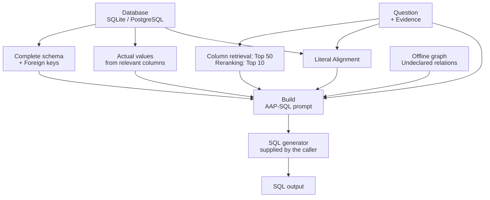

# AAP-SQL

**English** | [繁體中文](README.zh-TW.md)

**Prepare database schemas, relevant columns, and actual data values as prompts that help large language models translate natural-language questions into SQL.**

AAP-SQL implements the master's thesis *An Efficient and Low-Cost Adaptive Augmented Prompting Framework for Text-to-SQL Generation*. The repository brings together the research method, experiment tables, model training, relation discovery, BIRD evaluation, and a reusable Python core.

| Research dataset | SQL generation model | Thesis-reported Execution Accuracy |
|---|---|---|
| BIRD Dev `dev_20240627`, 1,534 questions across 11 SQLite databases | Gemini 2.5 Flash-Lite | **62.58% (960 / 1,534)** |

[Research](docs/research.md) · [Quick start](#quick-start) · [Core API](#using-the-core) · [Reproduction](docs/research-reproduction.md) · [Models](#models) · [Citation](#citation)

## What problem does it solve?

Text-to-SQL models need to know how tables connect, which columns relate to the question, and how filter values are actually stored. Including every column description and large amounts of data in a prompt increases token usage and can obscure the relevant information.

AAP-SQL **preserves the complete schema structure while adding semantic descriptions and data values for relevant columns**. For example, `alice` in a question can be aligned with the stored value `Alice`. Queries spanning multiple tables can use declared foreign keys and previously collected relationship cues.

| Technique | Purpose |
|---|---|
| Two-stage column retrieval | A fine-tuned retriever recalls 50 candidates; a reranker selects 10 core columns |
| Active value probing | Supplies actual values from relevant columns to help the model interpret query conditions |
| Literal Alignment | Aligns names and literals in the question with stored values, preserving their spelling and case |
| Relationship cues | Combines declared foreign keys with an offline graph of undeclared relationships to guide table joins |

## Workflow



The core prepares database context and calls the generator. The caller supplies the models, index, and LLM provider. The application or research runner validates and executes the resulting SQL.

## Quick start

Requires **Python 3.12+**. Install the package and run the offline example to see the core workflow:

### macOS / Linux

```bash
git clone https://github.com/Tommyweige/AAP-SQL.git
cd AAP-SQL
python3.12 -m venv .venv
source .venv/bin/activate
python -m pip install -e '.[test]'
python -m aap_sql.smoke
pytest -q
```

<details>
<summary>Windows PowerShell commands</summary>

```powershell
git clone https://github.com/Tommyweige/AAP-SQL.git
Set-Location AAP-SQL
py -3.12 -m venv .venv
.\.venv\Scripts\Activate.ps1
python -m pip install -e ".[test]"
python -m aap_sql.smoke
pytest -q
```

</details>

The example uses a temporary SQLite database and synthetic model/generator adapters to demonstrate retrieval, value probing, literal alignment, and SQL generation. It prints the assembled prompt and `Offline smoke passed` on success.

## Using the core

`AAPSQLPipeline` provides two entry points:

| Method | Returns |
|---|---|
| `prepare(question, db_id, evidence="")` | The assembled prompt, selected columns, literal hints, and retrieval metadata |
| `generate(question, db_id, generator, evidence="")` | A cleaned SQL string produced by the supplied generator |

Place SQLite databases at `databases/<db_id>/<db_id>.sqlite` and specify the database root through `DatabaseConfig`. You can also supply BIRD-format column-description metadata through `dev_tables_path`.

For PostgreSQL, install `.[postgres]` and supply a `PostgreSQLBackend` through
`DatabaseConfig(backend=backend, dev_db_path=None)`. The [backend integration guide](docs/database-backends.md)
covers read-only access, table allowlists, context hooks, error handling, and validation.

<details>
<summary>Python integration example and adapter interfaces</summary>

Pass your application's models, index, column mapping, and generator into the pipeline:

```python
from pathlib import Path
from aap_sql import AAPSQLPipeline, DatabaseConfig

pipeline = AAPSQLPipeline(
    database=DatabaseConfig(dev_db_path=Path("databases")),
    model=column_retriever,       # encode(texts, **kwargs)
    index=column_index,           # search(vectors, k) → distances, indices
    mapping=column_mapping,      # db_id, full_name, description
    reranker=candidate_reranker,  # predict(question/description pairs, **kwargs)
    normalize=normalize_vectors, # Normalize vectors in place, e.g. faiss.normalize_L2
    relation_path=None,          # Optional: path to the offline relationship graph JSON
)

question = 'Find the person named "Alice".'
prepared = pipeline.prepare(question, "demo")
sql = pipeline.generate(question, "demo", generator=my_generator)
```

The prompt retains the research version's ordering:

```text
Schema → Foreign Keys → Columns → Probed Values
       → Literal Alignment → Evidence → Question → SQL
```

The application manages database paths, model loading, and LLM clients. When sharing a model across threads, serialize inference according to the model's concurrency requirements.

</details>

## Research results and reproduction

The thesis compares all methods on BIRD Dev `dev_20240627` with **Gemini 2.5 Flash-Lite and Evidence** (Table 4-3):

| Method | Execution Accuracy | Total tokens |
|---|---:|---:|
| **AAP-SQL** | **62.58%** | **3,320,035** |
| DIN-SQL, thesis reproduction | 61.08% | 47,320,913 |
| CHESS, thesis reproduction | 61.21% | 42,428,725 |
| Baseline + Evidence | 57.76% | 2,188,308 |

AAP-SQL uses **92.98% fewer tokens than DIN-SQL** and **92.18% fewer than CHESS** in this setting. It improves execution accuracy by 4.82 percentage points over Baseline + Evidence. The [research overview](docs/research.md) includes training metrics, retrieval quality, generator comparisons, ablations, and per-question error transitions; [structured results](resources/bird_dev_20240627/thesis_results.json) preserve the source tables.

<details>
<summary>Thesis decoding settings and local runner defaults</summary>

| Setting | Value |
|---|---|
| Provider / region | Vertex AI / `global` |
| Generator | Gemini 2.5 Flash-Lite |
| Temperature / max output | `0.0` / `2048` tokens |
| Local inference / validation workers | 24 / 4 (operational settings) |
| SQL timeout | 60 seconds |

</details>

To reproduce the experiment, prepare BIRD `dev_20240627`, the fine-tuned retriever and reranker, an offline relation graph, and Vertex AI Application Default Credentials (ADC). The full run generates SQL for 1,534 questions through Vertex AI, with usage billed by the provider.

The [research reproduction guide](docs/research-reproduction.md) covers training, graph generation, paths, and execution parameters. The [method and validation record](docs/thesis-alignment.md) documents the implementation choices, including reconstructed numeric relation rules.

## Models

Fine-tuned weights are available on Hugging Face:

- [AAP-SQL column retriever](https://huggingface.co/TommyPanLab/AAP-SQL-Column-Retriever)
- [AAP-SQL candidate reranker](https://huggingface.co/TommyPanLab/AAP-SQL-Candidate-Reranker)

## Repository structure

| Path | Contents |
|---|---|
| [`src/aap_sql/`](src/aap_sql/) | Reusable pipeline, prompt assembly, retrieval, and SQLite/PostgreSQL backends |
| [`scripts/research/`](scripts/research/) | BIRD batch generation, caching, parallel validation, and research configuration |
| [`resources/bird_dev_20240627/`](resources/bird_dev_20240627/) | Two 798-column mappings, thesis results and relation-validation evidence |
| [`tests/`](tests/) | Core, backend, research utility, and local training tests |
| [`docs/`](docs/) | Research, reproduction, implementation, backend and engineering guides |

## Documentation

| Read this to… | Document |
|---|---|
| Understand the method and complete results | [Research overview](docs/research.md) |
| Prepare data/models and run experiments | [Reproduction guide](docs/research-reproduction.md) |
| Trace thesis sections to code and current choices | [Implementation notes](docs/thesis-alignment.md) |
| Inspect numeric mining assumptions and evidence | [Relation audit](docs/relation-reconstruction.md) |
| Integrate SQLite/PostgreSQL and context hooks | [Backend guide](docs/database-backends.md) |

## Citation

Tung-Wei Pan. *An Efficient and Low-Cost Adaptive Augmented Prompting Framework for Text-to-SQL Generation*. Master's thesis, National Dong Hwa University, June 2026.

[CITATION.cff](CITATION.cff) provides GitHub citation metadata; a BibTeX entry is in the [research overview](docs/research.md#citation).

## Contributing and license

See [CONTRIBUTING.md](CONTRIBUTING.md) for development checks and reporting experiments.

- [Thesis record and full-text information](https://hdl.handle.net/11296/rjag8t)
- [Apache-2.0 code license](LICENSE)

Dataset, mappings and model sources are described in the [research asset guide](resources/bird_dev_20240627/README.md). Downloaded data, weights and generated experiment outputs are managed locally.
