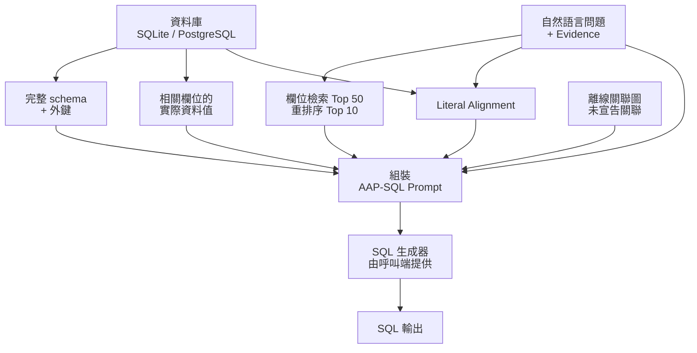

# AAP-SQL

[English](README.md) | **繁體中文**

**將資料庫 schema、相關欄位與實際資料值整理成 Prompt，協助大型語言模型將自然語言問題轉成 SQL。**

AAP-SQL 是碩士論文〈高效率低成本自適應增強提示之 Text-to-SQL 生成框架〉的實作。Repo 整合研究方法、實驗結果、模型訓練、關聯發現、BIRD 評估與可重用的 Python 核心。

*An Efficient and Low-Cost Adaptive Augmented Prompting Framework for Text-to-SQL Generation*

| 研究資料集 | SQL 生成模型 | 論文報告的 Execution Accuracy |
|---|---|---|
| BIRD Dev `dev_20240627`，1,534 題／11 個 SQLite 資料庫 | Gemini 2.5 Flash-Lite | **62.58%（960 / 1,534）** |

[研究整理](docs/research.md) · [快速開始](#快速開始) · [核心 API](#核心使用方式) · [重現流程](docs/research-reproduction.md) · [模型](#模型) · [引用](#引用)

## 專案解決什麼問題？

Text-to-SQL 模型需要知道資料表如何連接、哪些欄位與問題相關，以及條件值在資料庫中的實際寫法。將完整欄位描述和大量資料值全部放進 Prompt，會增加 token 用量，也容易讓重要資訊被淹沒。

AAP-SQL **保留完整 schema 骨架，集中補充相關欄位的語意與資料值**。例如，問題中的 `alice` 可以對齊資料庫裡實際儲存的 `Alice`；跨表查詢則可以參考已宣告外鍵與預先整理的關聯線索。

| 技術 | 用途 |
|---|---|
| 兩階段欄位檢索 | 微調檢索器召回 50 個候選，再由重排序器選出 10 個核心欄位 |
| 主動值探測 | 為相關欄位補上實際資料值，協助模型理解查詢條件 |
| Literal Alignment | 將問題中的名稱或字面值對齊資料庫值，保留正確大小寫與寫法 |
| 關聯線索 | 結合已宣告外鍵與離線未宣告關聯圖，提供跨表查詢依據 |

## 技術流程



核心負責準備資料庫脈絡與呼叫生成器；模型、索引和 LLM provider 由呼叫端提供。產生的 SQL 交由應用程式或研究 runner 驗證與執行。

## 快速開始

需要 **Python 3.12+**。安裝套件後，執行離線範例即可查看核心流程：

### macOS / Linux

```bash
git clone https://github.com/Tommyweige/AAP-SQL.git
cd AAP-SQL
python3.12 -m venv .venv
source .venv/bin/activate
python -m pip install -e '.[test]'
python -m aap_sql.smoke
pytest -q
```

<details>
<summary>Windows PowerShell 指令</summary>

```powershell
git clone https://github.com/Tommyweige/AAP-SQL.git
Set-Location AAP-SQL
py -3.12 -m venv .venv
.\.venv\Scripts\Activate.ps1
python -m pip install -e ".[test]"
python -m aap_sql.smoke
pytest -q
```

</details>

範例使用暫存 SQLite 與合成模型／生成器，展示檢索、值探查、literal 對齊與 SQL 生成。成功時會輸出組裝後的 Prompt，並顯示 `Offline smoke passed`。

## 核心使用方式

`AAPSQLPipeline` 提供兩個入口：

| 方法 | 回傳內容 |
|---|---|
| `prepare(question, db_id, evidence="")` | 組裝後的 Prompt、選取欄位、literal hints 與檢索 metadata |
| `generate(question, db_id, generator, evidence="")` | 呼叫指定生成器後，清理過的 SQL 字串 |

SQLite 資料庫依 `databases/<db_id>/<db_id>.sqlite` 放置，資料庫根目錄由 `DatabaseConfig` 指定。欄位描述也可透過 `dev_tables_path` 指定 BIRD 格式的 metadata。

使用 PostgreSQL 時，安裝 `.[postgres]`，並透過
`DatabaseConfig(backend=backend, dev_db_path=None)` 傳入 `PostgreSQLBackend`。
[Backend 整合指南](docs/database-backends.md) 說明唯讀權限、資料表白名單、context hooks、錯誤處理與驗證方式。

<details>
<summary>展開 Python 整合範例與 adapter 介面</summary>

將應用程式的模型、索引、欄位 mapping 與生成器傳入 pipeline：

```python
from pathlib import Path
from aap_sql import AAPSQLPipeline, DatabaseConfig

pipeline = AAPSQLPipeline(
    database=DatabaseConfig(dev_db_path=Path("databases")),
    model=column_retriever,       # encode(texts, **kwargs)
    index=column_index,           # search(vectors, k) → distances, indices
    mapping=column_mapping,      # db_id, full_name, description
    reranker=candidate_reranker,  # predict(question/description pairs, **kwargs)
    normalize=normalize_vectors, # 原地正規化向量，例如 faiss.normalize_L2
    relation_path=None,          # 可選：離線關聯圖的 JSON 路徑
)

question = 'Find the person named "Alice".'
prepared = pipeline.prepare(question, "demo")
sql = pipeline.generate(question, "demo", generator=my_generator)
```

Prompt 順序保持研究版本：

```text
Schema → Foreign Keys → Columns → Probed Values
       → Literal Alignment → Evidence → Question → SQL
```

資料庫路徑、模型載入與 LLM 用戶端由應用程式管理。多個執行緒共用模型時，依模型的並行需求序列化推理。

</details>

## 研究結果與重現

論文表 4-3 在 BIRD Dev `dev_20240627` 上，統一使用 **Gemini 2.5 Flash-Lite 與 Evidence** 比較各方法：

| 方法 | Execution Accuracy | 總 Token |
|---|---:|---:|
| **AAP-SQL** | **62.58%** | **3,320,035** |
| DIN-SQL，論文重現 | 61.08% | 47,320,913 |
| CHESS，論文重現 | 61.21% | 42,428,725 |
| Baseline + Evidence | 57.76% | 2,188,308 |

在此設定下，AAP-SQL 的 Token 用量比 **DIN-SQL 少 92.98%**、比 **CHESS 少 92.18%**，Execution Accuracy 比 Baseline + Evidence 高 4.82 個百分點。[研究整理](docs/research.md) 收錄訓練指標、檢索品質、生成模型比較、消融與逐題錯誤轉換；[結構化結果](resources/bird_dev_20240627/thesis_results.json) 保存論文表格數據。

<details>
<summary>論文解碼設定與本機 runner 預設</summary>

| 設定 | 值 |
|---|---|
| Provider / region | Vertex AI / `global` |
| Generator | Gemini 2.5 Flash-Lite |
| Temperature／最大輸出 | `0.0` / `2048` tokens |
| 本機推理／驗證 workers | 24 / 4（操作設定） |
| SQL timeout | 60 秒 |

</details>

重現實驗時，準備 BIRD `dev_20240627`、微調後的檢索器與重排序器、離線關聯圖，以及 Vertex AI Application Default Credentials（ADC）。完整流程透過 Vertex AI 為 1,534 題生成 SQL，服務用量依供應商計費。

[研究重現指南](docs/research-reproduction.md) 說明訓練、關聯圖產生、路徑與執行參數；[方法與驗證紀錄](docs/thesis-alignment.md) 整理實作選擇及數值關聯規則的反推依據。

## 模型

微調後的模型權重由 Hugging Face 提供：

- [AAP-SQL 欄位檢索器](https://huggingface.co/TommyPanLab/AAP-SQL-Column-Retriever)
- [AAP-SQL 候選重排序器](https://huggingface.co/TommyPanLab/AAP-SQL-Candidate-Reranker)

## Repository 結構

| 路徑 | 內容 |
|---|---|
| [`src/aap_sql/`](src/aap_sql/) | 可重用的 pipeline、Prompt 組裝、檢索與 SQLite/PostgreSQL backends |
| [`scripts/research/`](scripts/research/) | BIRD 批次生成、快取、並行驗證與研究設定 |
| [`resources/bird_dev_20240627/`](resources/bird_dev_20240627/) | 兩份 798 欄位 mapping、論文結果與關聯驗證紀錄 |
| [`tests/`](tests/) | 核心、後端、研究工具與本地訓練測試 |
| [`docs/`](docs/) | 研究、重現、實作、後端與工程導讀 |

## 文件導覽

| 閱讀目的 | 文件 |
|---|---|
| 理解研究方法與完整結果 | [研究整理](docs/research.md) |
| 準備資料／模型並執行實驗 | [重現指南](docs/research-reproduction.md) |
| 對照論文章節、程式與實作選擇 | [實作紀錄](docs/thesis-alignment.md) |
| 查看數值關聯規則與證據 | [關聯驗證](docs/relation-reconstruction.md) |
| 整合 SQLite／PostgreSQL 與 context hooks | [後端指南](docs/database-backends.md) |

## 引用

潘東瑋。〈高效率低成本自適應增強提示之 Text-to-SQL 生成框架〉。國立東華大學資訊工程學系碩士論文，2026 年 6 月。

[CITATION.cff](CITATION.cff) 提供 GitHub 引用資訊；BibTeX 收錄於[研究整理](docs/research.md#citation)。

## 貢獻與授權

開發檢查與實驗回報方式見 [CONTRIBUTING.md](CONTRIBUTING.md)。

- [論文書目與全文記錄](https://hdl.handle.net/11296/rjag8t)
- [Apache-2.0 程式碼授權](LICENSE)

資料集、mappings 與模型來源見[研究資源說明](resources/bird_dev_20240627/README.md)。下載的資料、權重與生成的實驗輸出由本機管理。
